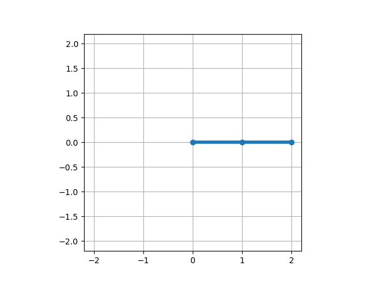
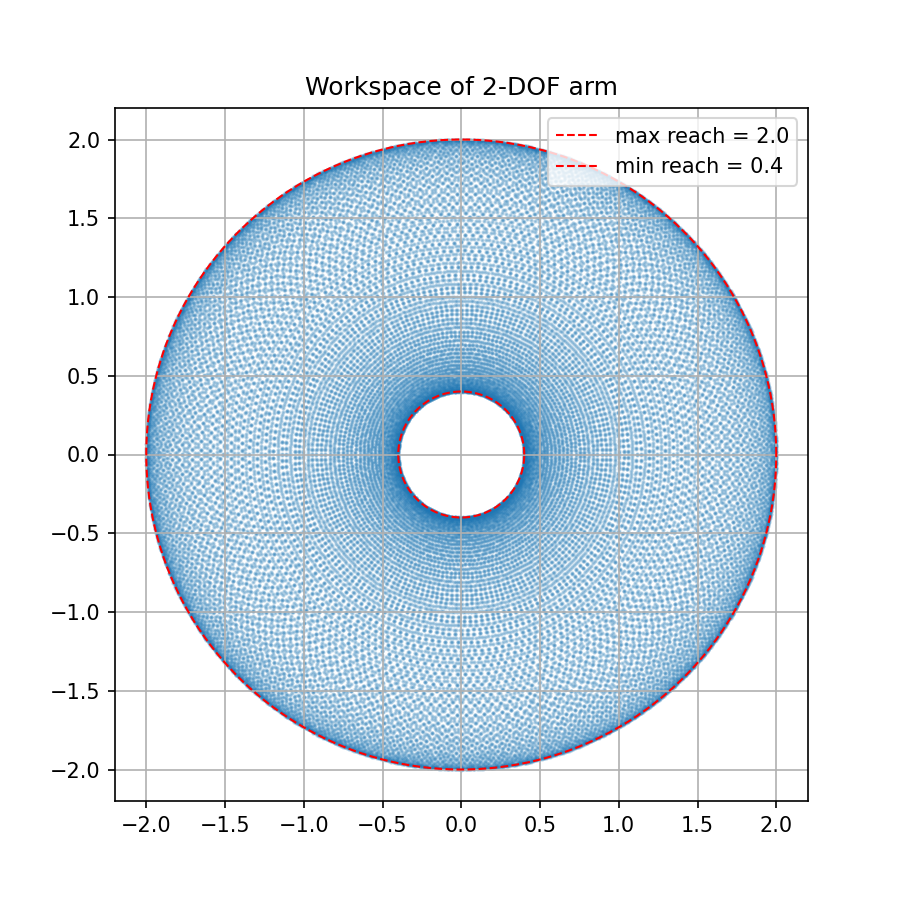
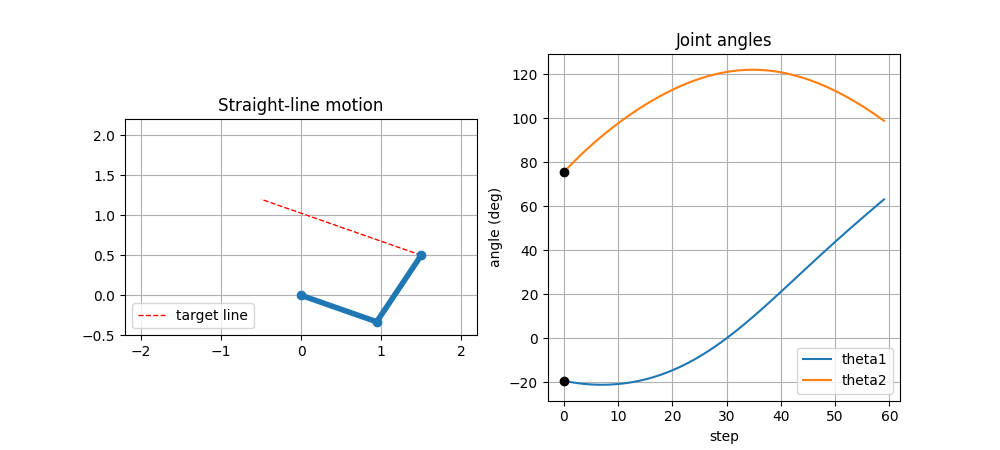

# Robot Arm Simulation

2-DOF planar robot arm simulation with forward and inverse kinematics, written in Python.

## Features
- Forward kinematics: joint angles -> end-effector position
- Inverse kinematics: target position -> joint angles (elbow-up / elbow-down)
- Animation of the arm tracing a circular trajectory
- Straight-line trajectory with joint angle plots
- Workspace visualization

## Kinematics

Forward kinematics (link lengths L1, L2, joint angles θ1, θ2):

    x = L1·cos(θ1) + L2·cos(θ1 + θ2)
    y = L1·sin(θ1) + L2·sin(θ1 + θ2)

Inverse kinematics:

    cos(θ2) = (x² + y² − L1² − L2²) / (2·L1·L2)
    θ1 = atan2(y, x) − atan2(L2·sin(θ2), L1 + L2·cos(θ2))

## Workspace

The reachable area is an annulus between |L1 − L2| and L1 + L2.

## Straight-line trajectory

The end-effector follows a straight line, but the joint angles change non-linearly.

## Installation

    pip install numpy matplotlib

## Usage

    python src/examples/circle_demo.py
    python src/examples/line_demo.py
    python src/examples/workspace_plot.py

## Project structure

    src/kinematics.py                 forward and inverse kinematics
    src/examples/circle_demo.py       circular trajectory animation
    src/examples/line_demo.py         straight-line trajectory
    src/examples/workspace_plot.py    workspace plot

## Future work
- 3-DOF arm
- Dynamics and PID control
- Obstacle avoidance
